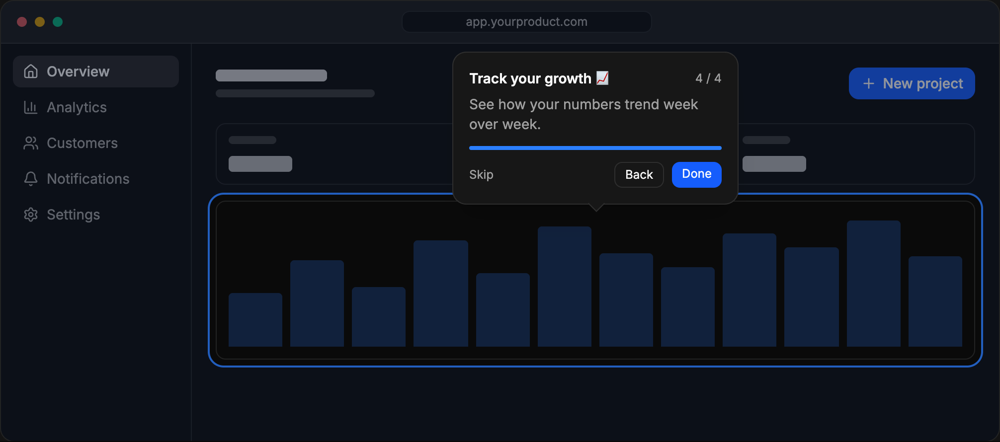

# Intro.js

[](https://github.com/usablica/intro.js/actions/workflows/nodejs.yml)
[](https://www.npmjs.com/package/intro.js)
[](https://www.npmjs.com/package/intro.js)
[](https://www.jsdelivr.com/package/npm/intro.js)

> User onboarding and product walkthrough library

<p align="center">
  <a href="https://introjs.com">
    
  </a>
</p>

## Why Intro.js

- **Self-hosted.** Tours run entirely in your app. No third-party service, no tracking script, no user data leaves your servers.
- **No runtime dependencies.** Plain JavaScript that works with any framework, or none.
- **Tours and hints.** Step-by-step walkthroughs with `introJs.tour()` and contextual hints with `introJs.hint()`.
- **Themes.** Built-in `dark`, `light`, `auto`, `modern`, `flattener`, `nassim`, `nazanin` and `royal` themes, plus your own. See the [theme guide](docs/theme-usage.md).
- **Localization.** 13 built-in languages (English, Spanish, French, German, Persian, Arabic, Russian, Chinese, Portuguese, Italian, Japanese, Turkish and Korean). The browser's language is picked automatically, or set one with the `language` option.
- **RTL support** and **TypeScript** source.

## Installation

```bash
npm install intro.js
# or
yarn add intro.js
```

Or load it from a CDN: [jsDelivr](https://www.jsdelivr.com/package/npm/intro.js) or [cdnjs](https://cdnjs.com/libraries/intro.js).

## Quick start

**1)** Include `intro.js` and `introjs.css` (or the minified versions). Add `introjs-rtl.css` for right-to-left languages.

```javascript
import introJs from "intro.js";
import "intro.js/introjs.css";
```

**2)** Define the steps, either in JavaScript:

```javascript
introJs
  .tour()
  .setOptions({
    steps: [
      { title: "Welcome", intro: "Let's take a quick tour." },
      { element: "#search", intro: "Search anything from here." },
      { element: ".settings", intro: "Your settings live here." },
    ],
  })
  .start();
```

or with `data-intro` attributes in your HTML:

```html
<button data-step="1" data-intro="Start here!">New project</button>
```

```javascript
introJs.tour().start();
```

See all [options](https://introjs.com/docs/intro/options) and [attributes](https://introjs.com/docs/intro/attributes).

**3)** Hints work the same way:

```javascript
introJs.hint().addHints();
```

## Documentation

- [Documentation](https://introjs.com/docs)
- [Theme guide](docs/theme-usage.md)
- [Examples](example/)
- Framework wrappers (React, Vue, Angular and more): see the [documentation](https://introjs.com/docs)

## Build

Install Node.js, then run:

```bash
npm install
npm run build   # build to dist/
npm run dev     # watch mode with a local server
```

## Contributors ✨

<!-- ALL-CONTRIBUTORS-LIST:START - Do not remove or modify this section -->
<!-- prettier-ignore-start -->
<!-- markdownlint-disable -->
<table>
  <tbody>
    <tr>
      <td align="center" valign="top" width="14.28%"><a href="http://afshinm.name"><br /><sub><b>Afshin Mehrabani</b></sub></a><br /><a href="https://github.com/usablica/intro.js/commits?author=afshinm" title="Code">💻</a> <a href="https://github.com/usablica/intro.js/commits?author=afshinm" title="Documentation">📖</a></td>
      <td align="center" valign="top" width="14.28%"><a href="https://bozdoz.com"><br /><sub><b>bozdoz</b></sub></a><br /><a href="https://github.com/usablica/intro.js/commits?author=bozdoz" title="Code">💻</a> <a href="https://github.com/usablica/intro.js/commits?author=bozdoz" title="Documentation">📖</a></td>
      <td align="center" valign="top" width="14.28%"><a href="https://github.com/Parvinmh"><br /><sub><b>Parvin Mehrabani</b></sub></a><br /><a href="https://github.com/usablica/intro.js/commits?author=Parvinmh" title="Code">💻</a> <a href="https://github.com/usablica/intro.js/commits?author=Parvinmh" title="Documentation">📖</a></td>
    </tr>
  </tbody>
</table>

<!-- markdownlint-restore -->
<!-- prettier-ignore-end -->

<!-- ALL-CONTRIBUTORS-LIST:END -->

## Support and discussion

- [GitHub Issues](https://github.com/usablica/intro.js/issues)
- [Stack Overflow](https://stackoverflow.com/questions/tagged/intro.js)

## Usage trends

- [Usage trends of product walkthrough libraries](https://npm-compare.com/intro.js,@reactour/tour,driver.js,vue-tour)

## License

Intro.js is dual-licensed.

### Commercial license

To use Intro.js in a commercial website, application, theme or plugin without releasing your source code, buy a commercial license at [introjs.com](https://introjs.com/#commercial).

### Open-source license

[GNU AGPLv3](license.md)
